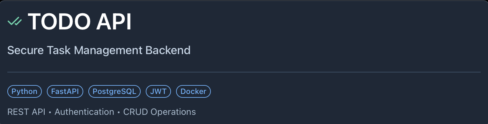
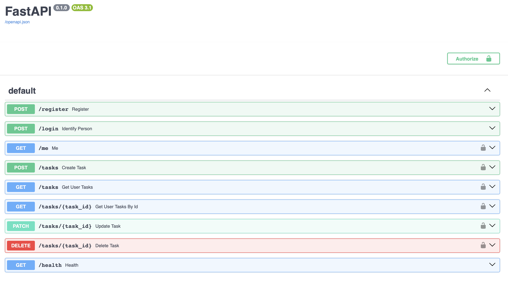

# Todo API

A RESTful backend application built with FastAPI and PostgreSQL.

The application allows users to register, authenticate using JWT tokens, and manage their personal tasks.

## Features

- User registration and authentication
- JWT-based authorization
- Secure password hashing
- Create, read, update, and delete tasks
- User-specific task management
- PostgreSQL database integration
- Docker support
- Cloud deployment with Railway
- Filter tasks by `completed` status
- Search tasks by title
- Manage database migrations using Alembic
- Automated API testing using pytest


## Tech Stack

- Python 3.12 (Docker) / 3.14 (local development)
- FastAPI
- PostgreSQL
- SQLAlchemy
- Pydantic
- JWT Authentication
- Docker
- Railway
- Alembic
- pytest


## Project Structure

```text
todo_api/
├── alembic/
│   ├── versions/
│   │   └── a2e986748e3c_initial_schema.py
│   ├── README
│   ├── env.py
│   └── script.py.mako
├── images/
│   ├── banner.png
│   └── swagger.png
├── routers/
│   ├── __init__.py
│   ├── users.py
│   └── tasks.py
├── tests/
│   ├── conftest.py
│   ├── test_health.py
│   ├── test_login.py
│   ├── test_register.py
│   └── test_tasks.py
├── .dockerignore
├── .env.example
├── .gitignore
├── alembic.ini
├── auth.py
├── database.py
├── Dockerfile
├── main.py
├── models.py
├── requirements-dev.txt
├── requirements.txt
├── schemas.py
└── README.md
```


## API Endpoints

### Authentication

| Method | Endpoint | Description |
|--------|----------|-------------|
| POST | /register | Register a new user |
| POST | /login | Authenticate and receive JWT |
| GET | /me | Get current user information |

### Tasks

| Method | Endpoint | Description |
|--------|----------|-------------|
| GET | /tasks | Retrieve user's tasks |
| POST | /tasks | Create a new task |
| PATCH | /tasks/{task_id} | Update an existing task |
| DELETE | /tasks/{task_id} | Delete a task |
| GET | /tasks/{task_id} | Retrieve a specific task |

### Task Filtering and Search

The `GET /tasks` endpoint supports optional query parameters:

- `completed` — filter tasks by completion status.
- `search` — search tasks by title.


### Health Check

| Method | Endpoint | Description |
|--------|----------|-------------|
| GET | /health | Check API health |


## Installation

### 1. Clone the repository

```bash
git clone https://github.com/JustAndrii/todo_api.git
cd todo_api
```

### 2. Create a virtual environment

```bash
python3 -m venv .venv
source .venv/bin/activate
```

### 3. Install dependencies

```bash
pip install -r requirements.txt
```

### 4. Configure environment variables

Copy the example environment file:

```bash
cp .env.example .env
```

Update `.env` with your own PostgreSQL credentials and JWT secret key.

Make sure PostgreSQL is installed and running, and the database specified in `DATABASE_URL` exists.

### 5. Apply database migrations

Before starting the application, apply the database migrations to create or update the PostgreSQL schema.

Make sure your database is configured correctly in the `.env` file.

Run:

```bash
alembic upgrade head
```

This command applies all pending Alembic migrations.

### 6. Run the application

```bash
uvicorn main:app --reload
```

Open the interactive API documentation:

http://127.0.0.1:8000/docs


## Testing

The project includes automated API tests using pytest.

The test suite covers:

- User registration and authentication
- Successful and unsuccessful login attempts
- JWT-protected endpoints
- Task creation and retrieval
- Task title validation
- User-specific access control
- Health endpoint

### Install development dependencies

```bash
pip install -r requirements-dev.txt
```

### Configure the test database

The test suite uses a separate PostgreSQL database named `todo_api_alembic_test`.

Before running the tests:

1. Make sure PostgreSQL is running.
2. Create a database named `todo_api_alembic_test` if it does not already exist.
3. Apply the Alembic migrations to the test database.

To apply migrations without modifying the main `.env` file, run the following command from the project root:

```python
import os
from dotenv import load_dotenv
from sqlalchemy.engine import make_url
from alembic.config import Config
from alembic import command

load_dotenv(".env")

url = make_url(os.environ["DATABASE_URL"])

if url.database != "todo_db":
    raise ValueError("Expected main database: todo_db")

test_url = url.set(database="todo_api_alembic_test")

os.environ["DATABASE_URL"] = test_url.render_as_string(
    hide_password=False
)

command.upgrade(Config("alembic.ini"), "head")
```

Execute the code above as a one-time Python script.

**Important:** The main database (`todo_db`) and test database (`todo_api_alembic_test`) must remain separate.

The test fixture uses SQLAlchemy transactions and SAVEPOINTs to isolate changes and roll them back after each test.


## Docker

The project includes a Dockerfile for containerized deployment.

The Docker image installs the required dependencies and runs the FastAPI application using Uvicorn.

Environment variables must be provided when running the container. PostgreSQL should be configured separately.

## Deployment

The application was successfully deployed on Railway using Docker and PostgreSQL.

The deployment includes:

- A Dockerized FastAPI application
- A separate PostgreSQL service
- Environment variables for database credentials and JWT configuration
- A public HTTPS domain
- Interactive API documentation via Swagger UI

Registration, authentication, and CRUD operations were tested successfully in the deployed environment.

**Note:** The public Railway services are currently stopped to avoid unnecessary hosting costs.


## Screenshots

### Swagger UI

Interactive API documentation showing all available endpoints.


